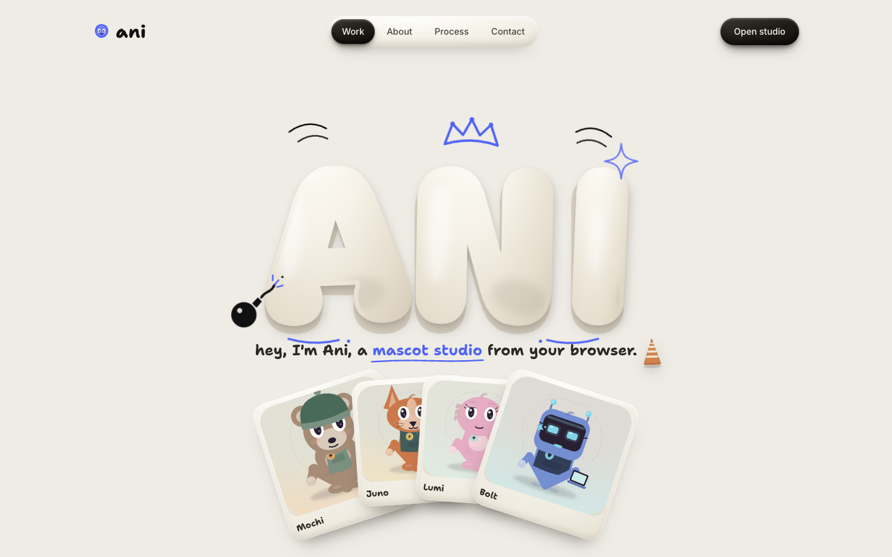
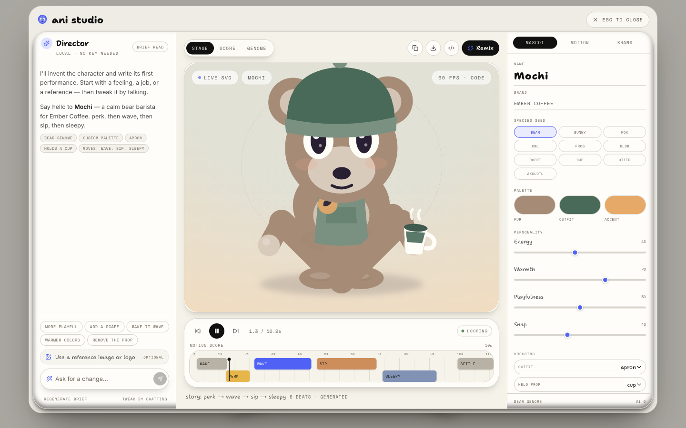
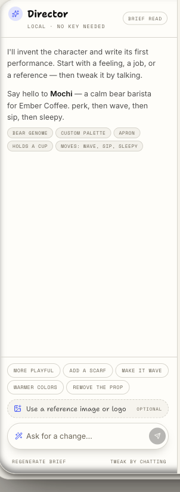
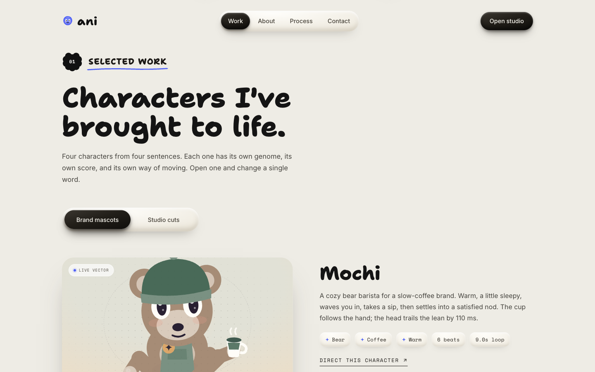

# Ani — mascots that move

**Live:** [pranavk429.github.io/ani-toon](https://pranavk429.github.io/ani-toon/) · **Repo:** [pranavk429/ani-toon](https://github.com/pranavk429/ani-toon)

**Describe a feeling. Meet a character that moves like it means it.**

Ani is a no-code mascot studio. You type — or speak with **Wispr Flow** — a short brand brief. Ani invents an original vector creature and writes a one-of-a-kind performance for it, then renders every frame live in the browser.

No mascot library. No canned move list. No video model. No server. No API key.



## The 30-second version

1. A brief goes in: *“A cozy bear barista named Mochi for Ember Coffee. Warm, a little sleepy, waves hello and sips a latte.”*
2. The **director** turns it into a **creature genome** (head, ears, face, body, palette, outfit, prop, personality) and a **motion score** (beats, timing, weight, gaze, blinks, accents).
3. The **compiler** layers those beats with breath, weight shift, follow-through, blinks and idle life.
4. The **renderer** draws true SVG at 60fps — about 10KB for the exported frame, not a video.

## What makes it different

- **Generative, not selective.** Species presets are seeds, not a gallery. A seeded genome morphs proportions, palette, personality and details on every generation. The same brief never produces the exact same performance twice.
- **A motion language, not a clip library.** Beats are channel-level poses (arm angle, lean, gaze, lid, prop tilt). They are mirrored, stretched, scaled by personality and overlapped, then surrounded by procedural idle motion and follow-through. There is no “wave.mp4”.
- **Real vector output.** Every mascot is SVG geometry. Transparent, crisp at any size, editable, tiny. Export the current frame as `.svg` or the full genome + score as `.json`.
- **Image input.** Drop a reference. Ani reads its palette, chroma and temperature in the browser, infers a creature seed, and builds an original interpretation — never a pixel trace. A separate logo upload is placed exactly on the chest badge and scales with the SVG.
- **Chat editing.** “More playful.” “Add a scarf.” “Make it wave.” “Warmer colors.” “Remove the prop.” The same character changes, and the score recompiles.
- **Honest constraints.** No account, no upload, no network call, no key. The whole studio works offline after the page loads.



## How it works

```
brief / image
      │
      ▼
┌──────────────┐     words → traits      ┌──────────────┐
│   director   │ ──────────────────────▶ │    genome    │
│  parse/edit  │                         │  proportions │
└──────┬───────┘                         │  palette     │
       │                                 │  personality │
       │ verbs → beats                   └──────┬───────┘
       ▼                                        │
┌──────────────┐    layer idle + follow-through │
│ motion score │ ───────────────┐               │
│ beats, gaze  │                ▼               ▼
│ blinks       │          ┌────────────────────────┐
└──────────────┘          │      compiler           │
                          │  flow / swing / blink   │
                          └───────────┬────────────┘
                                      ▼
                          ┌────────────────────────┐
                          │    SVG renderer        │
                          │  one clock → one pose  │
                          └────────────────────────┘
```

The motion engine is a web port of the [Rossark motion method](https://github.com/rossark0/rossark-motion-skill): one clock, eased `flow` poses, follow-through by delay, seeded idle layers, asymmetric blinks, weight shift with leg compensation, and volume-preserving squash.

## Run it

```bash
pnpm install
pnpm dev
```

Open `http://localhost:3000`.

```bash
pnpm build      # production build
pnpm start      # serve the production build
pnpm lint
```

No environment variables are required.

## Using the studio

- **Open the studio** from the nav, the contact CTA, or by clicking any character card.
- **Talk** instead of typing: hold `Fn` + `Space`, dictate a brief with **Wispr Flow**, then press Generate.
- **Reference image**: use the image button in the chat. The extracted palette and inferred seed are shown as a message; the character is an original vector interpretation.
- **Logo**: in the inspector’s **Brand** tab, upload a PNG/SVG. It becomes the chest badge.
- **Edit by chat**: try the suggestion chips, or type your own instruction.
- **Scrub**: click the score blocks or drag the transport slider.
- **Inspect**: switch the stage to `SCORE` or `GENOME` to see the generated data.
- **Export**: SVG (current frame) from the stage toolbar, JSON (genome + score) from the Brand tab, or copy a share link.

## Wispr Flow

Wispr Flow is the input layer for the product and the build. Every demo brief is spoken, not typed. Inside the studio, the prompt bar is a normal text field, so Wispr Flow can dictate into it from anywhere; the UI explicitly surfaces the `Fn` + `Space` shortcut. No fake microphone permission prompt, no hidden recording.



## Design

The visual language is adapted from the measured system of [yashb.xyz](https://yashb.xyz/): warm bone paper `#efece4`, one electric blue accent `#4b63ff`, Shantell Sans for the hand-drawn voice, Space Mono for telemetry, Bagel Fat One for the puffy display lettering, 1140px container, 108px rhythm, hairline borders, and physical pill navigation.

The adaptation was measured with **DesignProbe**, then re-observed in **ego lite** at 1440 and 390 for the final pass. The landing follows the reference's five-section rhythm; the studio opens as an overlay so the page keeps that calm. The gate passes at 82.2/100 with zero contrast, tap-target or overflow failures. No reference copy, photography, illustration or assets were reused.



## Stack

- Next.js 16 (App Router, static-renderable) + React 19 + TypeScript
- Tailwind CSS v4 with the measured design tokens
- Hand-built SVG renderer; no animation library at runtime
- `next/font` for self-hosted Inter, Shantell Sans, Space Mono and Bagel Fat One
- Everything client-side. No database, server action, API key or analytics.

## Known limits

- The local director is a deterministic language + trait engine, not an LLM. It is intentionally zero-key and reliable for a live demo.
- Image reading extracts palette, chroma, temperature and a hue-based creature seed; it does not do semantic vision or facial reconstruction. The result is an original interpretation, not a trace.
- Shared links encode the genome + score in the URL (about 3KB); logo image data is not included.
- Exported SVG is the current frame, not a video or an SMIL timeline. The JSON is the canonical, replayable artifact.

## Credits

- Motion method inspired by [rossark0/rossark-motion-skill](https://github.com/rossark0/rossark-motion-skill) (MIT).
- Design reference: [yashb.xyz](https://yashb.xyz/) (aesthetic study only; no assets or copy).
- Typefaces: Inter, Shantell Sans, Space Mono, Bagel Fat One, via Google Fonts / `next/font`.
- Built for the **WeMakeDevs × Wispr Flow** challenge, **Track 2 — No-Code**.

## License

MIT — see [LICENSE](LICENSE).
