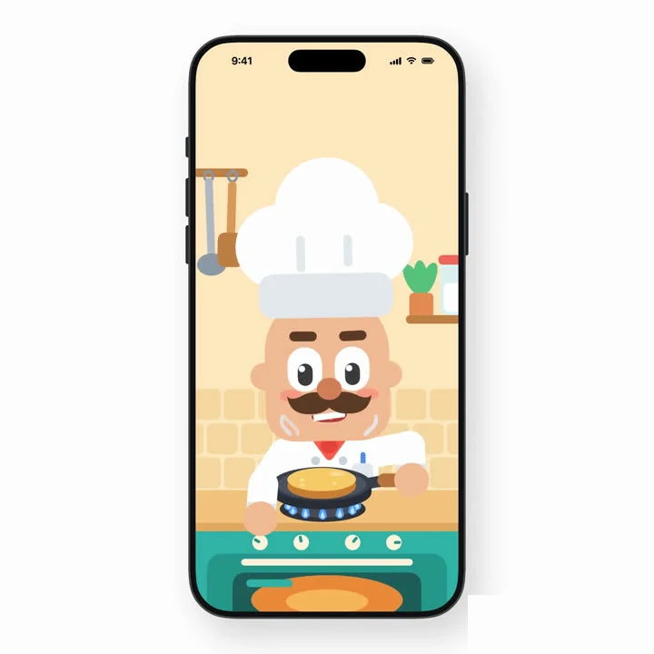
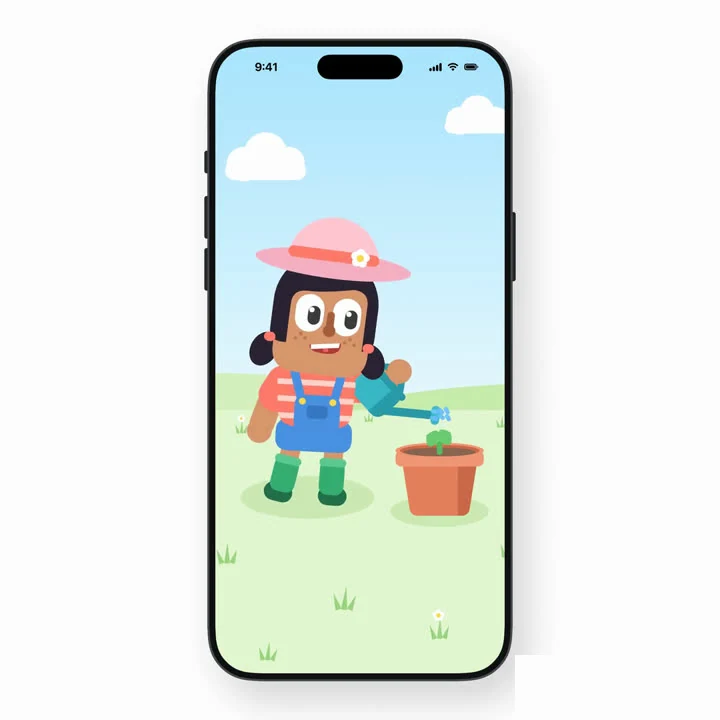
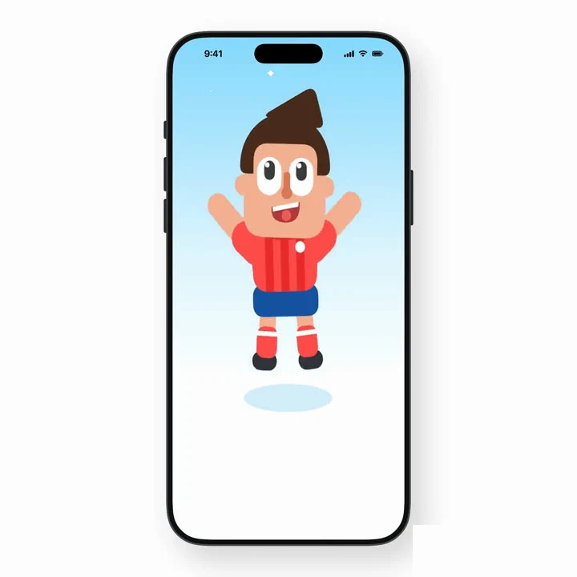
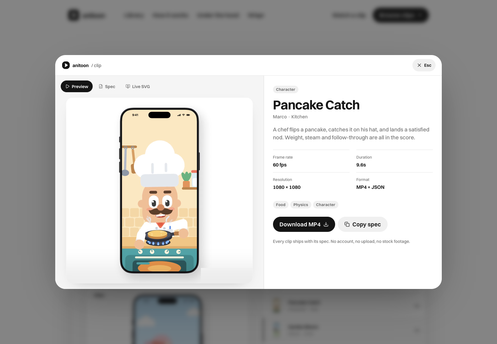
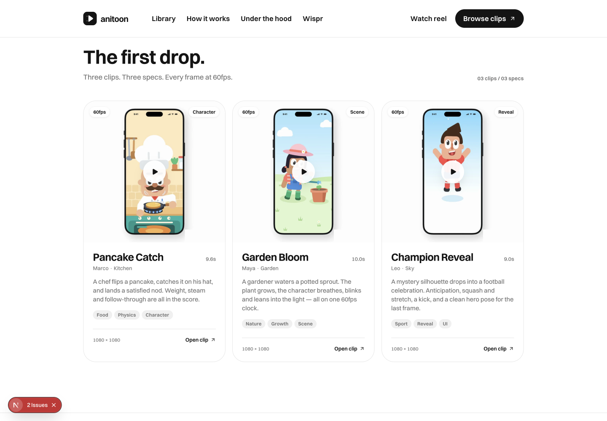
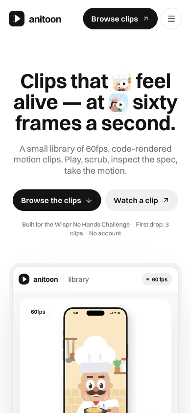

# Anitoon

**A small library of 60fps, code-rendered motion clips.**

[Live demo](https://pranavk429.github.io/ani-toon/) · [GitHub](https://github.com/pranavk429/ani-toon) · [The viewer](#the-viewer) · [Run locally](#run-locally) · [Design system](docs/DESIGN.md)

Built for the **Wispr No Hands Challenge** by WeMakeDevs — **Track 2: No-Code**, October 2026.


## What it is

Anitoon is a deliberately small motion library: **three clips, three specs, every frame at 60fps**.

Each clip is a real render with the JSON that made it. You can watch the MP4, read the spec, or run the same spec as a live SVG render. No stock footage, no fake logo wall, no 100,000-clip promise — just the first drop, with the receipts.

- **60fps** — rendered from one clock, not sampled from a GIF.
- **1080 × 1080** — a square stage for feeds, product pages and app heroes.
- **Spec included** — the source JSON is part of the clip.
- **Two outputs** — the finished MP4 and the live SVG render.
- **No account, no uploads, no analytics** — the site is a static page.

## The first drop

| | | |
| :---: | :---: | :---: |
|  |  |  |
| **Pancake Catch** | **Garden Bloom** | **Champion Reveal** |
| Marco · Character · 9.6s | Maya · Scene · 10.0s | Leo · Reveal · 9.0s |
| [spec](public/specs/chef-demo.json) · [MP4](public/videos/chef.mp4) | [spec](public/specs/garden-demo.json) · [MP4](public/videos/garden.mp4) | [spec](public/specs/reveal-demo.json) · [MP4](public/videos/reveal.mp4) |

Every clip is also available in the live viewer with a full-resolution preview, the spec JSON, and the live SVG render.

## The viewer



The viewer has three tabs on the same clip:

1. **Preview** — the finished 60fps MP4.
2. **Spec** — the real JSON, with a copy button.
3. **Live SVG** — the same spec compiled and rendered live in the browser.

The download button gives you the MP4; the copy button gives you the exact spec. No proprietary export format and no locked player.

## The library



The landing is a working library, not a screenshot of one:

- The hero product frame autoplays the selected clip at 60fps.
- Selecting a row switches the clip, the preview, the copy and the metadata.
- The preview pauses when it leaves the viewport.
- The library cards open the full viewer.
- Everything is keyboard accessible, and reduced-motion users get the poster instead of autoplay.

<p align="center">
  
</p>
<p align="center"><em>390px: one column, same viewer, no horizontal overflow.</em></p>

## How it works

1. **Browse** — open the first drop and watch a clip.
2. **Inspect** — read the spec or switch to the live SVG render.
3. **Take it** — download the MP4, copy the spec, or use the live render.

## Built for the challenge

The Wispr challenge asked for a build without typing. The clips, the specs and this page were directed with **Wispr Flow**.

The site tells that story once and then gets out of the way. It does **not** request a microphone, fake a product integration or claim a company logo wall. The voice was the build tool; the library is the product.

**Not a SaaS:** no pricing, no login, no MCP server, no fake customers, no invented case studies. Just a small, honest motion library.

## Design

The visual system is adapted from the measured language of [Mobbin](https://mobbin.com/):

- white canvas, ink `#141414`, secondary `#707070`, tile `#f2f2f2`
- **Switzer variable** (the closest free metric match to Saans) at the measured weights
- 80/44/24/20/16/14/12 type ramp, tight display tracking, 1045px container
- 30px cards, black pills, hairline borders, 150ms state motion
- oversized headline with inline clip thumbnails, six-tile bento, gray quote band, rounded black footer

The full token and component notes are in [docs/DESIGN.md](docs/DESIGN.md). No Mobbin copy, screenshots, logo, client marks or font files are used.

## Run locally

```bash
pnpm install
pnpm dev
```

Open [http://localhost:3000](http://localhost:3000).

```bash
pnpm build      # production build
pnpm start      # serve the production build
pnpm lint
pnpm typecheck
```

No environment variables are required.

## Verification

Measured in a production build with **DesignProbe** and re-checked in **ego lite** at 1440, 768 and 390.

```text
Structural     88.8 / 100   PASS (budget 80)
Contrast        0 failures
Tap targets     0 under 24px
Focus visible   100% (32/32)
Overflow @390   0px
CLS             0.000
Transfer        420KB / 600KB
Requests        18
```

The gate’s remaining suggestions are component-count deltas: Mobbin is a large design library with 261 images, while Anitoon is a deliberate three-clip drop. Adding filler would break the “no fake content” rule, so the count is left honest.

Run it yourself:

```bash
pnpm dev
designprobe-plugin gate --project . --url http://localhost:3000
```

## Project structure

```text
src/app/                  Next.js routes, layout, global tokens
src/components/anitoon/   Landing, library, viewer, footer
src/data/clips.ts         The three clips and their metadata
src/toon/                 SVG motion engine + live renderer
public/videos/            Full 1080p MP4s + 600px 60fps previews
public/specs/             The source specs for every clip
public/images/            Posters and hero thumbnails
docs/                     Screenshots and design notes
```

## Deploy

**GitHub Pages** — push to `main`. The workflow in `.github/workflows/pages.yml` builds with `GITHUB_PAGES=true`, writes `out/`, and deploys to:

```text
https://pranavk429.github.io/ani-toon/
```

**Vercel / any Next host** — import the repo, run `pnpm build`, and serve. Set `NEXT_PUBLIC_SITE_URL` to the final domain if you want absolute OG metadata.

## Stack

- Next.js 16 (App Router, static-renderable) + React 19 + TypeScript
- Tailwind CSS v4 with the measured design tokens
- `next/font/local` for Switzer
- Hand-built SVG motion engine; no animation library at runtime
- Real 60fps MP4s, real JSON specs, no database or server

## Credits

- **Challenge:** [Wispr Flow](https://wisprflow.ai/) × [WeMakeDevs](https://www.wemakedevs.org/wispr)
- **Design reference:** [Mobbin](https://mobbin.com/) — aesthetic study only; no assets, copy or fonts reused
- **Typeface:** Switzer via Fontshare (ITF Free Font License)
- **Icons:** Lucide
- **Motion method:** inspired by [rossark0/rossark-motion-skill](https://github.com/rossark0/rossark-motion-skill) (MIT)

## License

MIT — see [LICENSE](LICENSE).
