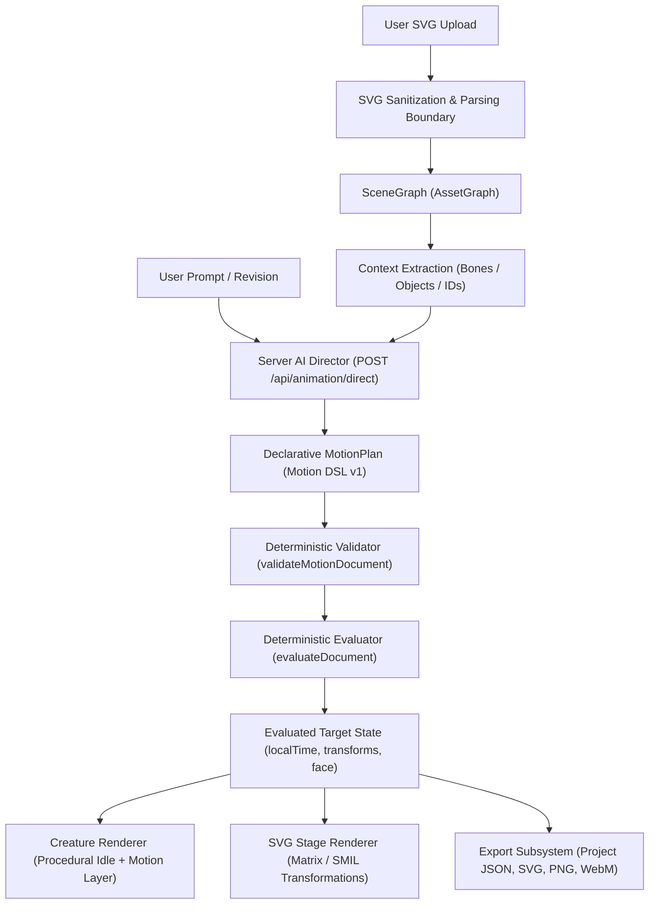

# ANI Studio & Anitoon Architecture

This document provides a technical specification of the ANI studio vector animation engine, its core contracts, execution pipeline, determinism guarantees, and export boundaries.

---

## 1. System Overview

ANI is an AI-directed, deterministic vector animation studio built for two unified scene sources:
1. **Procedural Storybook Characters** (`src/creature/*`): Rigged flat-cel vector actors with hierarchical bones, facial channels, and stage props (`SceneObject`).
2. **Imported SVG Assets** (`src/lib/svg/*`): Sanitized vector scene graphs whose elements are targeted by stable, validated element IDs.

Both scene paradigms compile into a single declarative format: **Motion DSL v1** (`MotionDocument` / `MotionPlan`). The client evaluates this document deterministically at any timestamp `t` without running untrusted code.



---

## 2. Core Shared Contracts

All core contracts are defined in `src/lib/studio/contracts.ts`, `src/lib/ai/contracts.ts`, `src/lib/animation/types.ts`, and `src/creature/types.ts`.

### IllustrationStyle (`ILLUSTRATION_STYLE_ID = "anitoon-storybook-v1"`)
Enforces the hard-cel, flat-vector mascot visual language:
- **Palette**: Paper (`#FEFDF9`), ink (`#2B2420`), skin ramp, garment tones, accent tones, shadow (`#2B242026`).
- **Proportions**: Bounded scaling factors for head, torso, limb width, eye size, and eye spacing.
- **Shape Language**: Rounded corners, zero outlines on skin/cloth, flat cel shading, low detail budget.
- **Background**: Flat horizon, zero gradients, flat planes.

### CharacterGenome & RigDefinition
- **CharacterGenome**: Wraps persistent character identity (`schemaVersion: 1`, `styleId`, `seed`, `genome`). Modifying animations never mutates the underlying genome.
- **RigDefinition**: The skeletal topology generated from a genome (`schemaVersion: 1`, `root`, `skeleton`, `boneCount`).

### AssetGraph (`SceneGraph`)
The validated, sanitized representation of an imported SVG:
- Preserves viewBox, dimension metrics, and hierarchical elements.
- Provides bounding box coordinates (`BBox`), computed styles, and stable unique identifiers (`SceneElement`).

### MotionPlan (`MotionDocument`)
The declarative animation contract (`version: 1`, `fps: 60`, `duration: 0.2..60`):
- **Tracks**: Array of `MotionTrack`, each pairing a specific `MotionTarget` with a `MotionProperty` and normalized `Keyframe[]` (`at: 0..1`, `value`, `easing`).
- **Loop**: Mode (`"restart" | "pingpong"`), enabled boolean, iteration limits.
- **Meta**: Source provenance (`"ai" | "fallback" | "preset" | "manual"`), provider, model, latency, warnings.

### AniProject (Lossless Project Model)
Canonical file format (`schemaVersion: 1`, file extension `.ani.json`):
- `id`: Unique project ID.
- `name`: Human-readable title.
- `createdAt` & `updatedAt`: ISO 8601 timestamps.
- `source`: Discriminated union of `{ kind: "character", scene: Scene }` or `{ kind: "svg", graph: SceneGraph, sourceSvg: string, filename?: string }`.
- `motion`: Complete `MotionDocument`.
- `prompt`: Original user instruction kept for auditability.
- `thumbnail`: Lightweight base64/data-URL representation.

---

## 3. Motion Target Kinds & Properties

A motion document specifies `targetKind: "svg" | "character"`. Tracks specify targets via:
```typescript
type MotionTarget =
  | { kind: "svg"; elementId: string }
  | { kind: "character"; actorId: string; boneId: string }
  | { kind: "object"; objectId: string };
```

### Property Matrix

| Property Name | Target Scope | Description / Value Range |
|---|---|---|
| `translateX`, `translateY` | SVG, Root Bone, Object | Offset in coordinate units (+Y is down in plan). Only valid on root bone for characters. |
| `rotate` | SVG, Bone, Object | Joint or element rotation in degrees. |
| `scale`, `scaleX`, `scaleY` | SVG, Bone, Object | Multiplicative scale factors. |
| `opacity` | SVG, Object | Alpha visibility (`0.0 .. 1.0`). |
| `fill`, `stroke` | SVG, Object | Hex color strings. |
| `strokeWidth` | SVG | Stroke width in user units. |
| `strokeDraw` | SVG (Path-like) | Progressive stroke reveal (`0.0` invisible, `1.0` fully drawn). |
| `motionPath` | SVG | Parametric path progression with optional auto-orientation. |
| `faceBlink`, `faceMouth` | Character (Head Bone) | Facial expression channels (`0.0 .. 1.0`). |
| `faceLookX`, `faceLookY` | Character (Head Bone) | Eye gaze direction offsets (`-1.4 .. +1.4`). |
| `faceWink`, `faceCheek` | Character (Head Bone) | Facial accent multipliers (`0.0 .. 1.0`). |
| `faceExpression` | Character (Head Bone) | Discrete expression index (`0`: neutral, `1`: happy, `2`: surprised, `3`: thinking, `4`: shy, `5`: laugh, `6`: sleepy, `7`: wink). |

---

## 4. Deterministic Evaluation Engine

The runtime (`src/lib/animation/evaluate.ts` and `runtime.ts`) evaluates motion strictly as a pure function of time:
$$\text{state}(t) = \text{evaluateDocument}(\text{document}, t)$$

### Determinism Rules:
1. **Clock Normalization**: Loop handling maps global time $t$ to $[0, \text{duration}]$ using either modulo restart or ping-pong folding.
2. **Track Windowing**: Keyframe interpolation occurs strictly within $[\text{delay}, \text{delay} + \text{duration}]$. Before the window start, it clamps to the first keyframe; after the window, it clamps to the last keyframe.
3. **Easing Interpolation**: Easing functions (linear, quad, cubic, back, spring, or cubic-bezier) map normalized progress $p \in [0, 1]$ to real values without frame-rate jitter or accumulator drift.
4. **No Code Execution**: The Motion DSL is pure declarative JSON. No arbitrary JavaScript or user scripts are ever evaluated.

---

## 5. Character & Object Motion Adapter

Implemented in `src/creature/motion.ts`, `applyMotionToScene` bridges the Motion DSL with the creature pose renderer:
- **Preserved Idle Layer**: The character's procedural breathing, eye blinks, and gait cycles run continuously. The AI motion plan layers on top as additive or multiplicative delta offsets.
- **Bone Rig Boundaries**: Joint rotations and scales are clamped against physical anatomy limits (`limitsForBone`).
- **Coordinate System Mapping**: Document $+Y$ is down; character skeleton $+Y$ is up. The adapter translates `actorPose.root.y -= state.translateY` cleanly.
- **Object Layering**: Independent scene objects (`SceneObject`) render in front or back visual layers with stage coordinate positioning ($720 \times 720$).

---

## 6. SVG Sanitization & Security Boundary

Implemented in `src/lib/svg/sanitize.ts` and `parse.ts`:
- **Strict Element Allowlist**: Permitted elements: `svg`, `g`, `path`, `rect`, `circle`, `ellipse`, `line`, `polyline`, `polygon`, `text`, `tspan`, `defs`, `linearGradient`, `radialGradient`, `stop`, `clipPath`.
- **Blocked Elements**: `<script>`, `<foreignObject>`, `<iframe>`, `<embed>`, `<object>`, `<a>`, `<audio>`, `<video>`, and event attributes (`onclick`, `onload`, etc.) are stripped or rejected.
- **Reference Integrity**: Malicious DOCTYPEs, external URLs, entity expansions (billion laughs), and cross-origin resource links are blocked. Fragment references (`url(#id)`) are sanitized and assigned collision-free identifiers.
- **ID Stability**: Elements lacking IDs receive stable synthetic IDs (`el-1`, `el-2`, etc.) based on document traversal order.

---

## 7. Project Persistence

Implemented in `src/lib/project-store/index.ts`:
- **Primary Storage**: Browser **IndexedDB** (`ani-studio` database, `projects` object store) to accommodate large SVGs and extensive motion documents beyond typical quota limits.
- **Fallback**: LocalStorage mirror (`ani-studio-projects-v1`) activated only if IndexedDB is disabled or unavailable.
- **CRUD Operations**: Complete support for `saveProject`, `loadProject`, `listProjects`, `deleteProject`, and `touchProject`.

---

## 8. Export Matrix & Capabilities

Implemented across `src/lib/studio-export/index.ts` and `src/lib/animation/exportSvg.ts`:

| Export Format | Implementation Status | Pipeline / Mechanism | Target Support |
|---|---|---|---|
| **Project JSON (`.ani.json`)** | Implemented | Canonical lossless serialization with schema validation (`parseProjectJson`, `downloadProject`). | SVG & Character |
| **Stage SVG (Snapshot)** | Implemented | XMLSerializer DOM clone with inline XML namespace injection. | SVG & Character |
| **Standalone Animated SVG** | Implemented | SMIL compilation (`<animateTransform>` decomposition and `<animate>` paint tracks). | SVG targets only |
| **Raster PNG Snapshot** | Implemented | Canvas 2D rasterization of rendered SVG markup at $1080 \times 1080$. | SVG & Character |
| **WebM Video** | Implemented | Deterministic frame rasterization to `<canvas>` captured via browser `MediaRecorder` ($1080 \times 1080$, max 20s, max 30fps). | SVG & Character |
| **Server-Side MP4 (Remotion/FFmpeg)** | Planned | Cloud rendering infrastructure for server-side MP4 generation. | Planned |

---

## 9. Implementation vs. Planned Features

### Currently Implemented
- [x] Server-side Director contract & provider interfaces (`src/lib/ai/contracts.ts`).
- [x] Motion DSL v1 schema, validation, easing, and path math (`src/lib/animation/*`).
- [x] Deterministic 60fps timeline evaluator and playback runtime (`src/lib/animation/evaluate.ts`, `runtime.ts`).
- [x] Character procedural skeletal rig + object motion layering (`src/creature/motion.ts`, `objects.ts`).
- [x] Allowlist-based SVG security sanitizer and scene graph extractor (`src/lib/svg/*`).
- [x] Browser IndexedDB project persistence (`src/lib/project-store/*`).
- [x] Client-side exports: `.ani.json`, static SVG, SMIL animated SVG, PNG, and WebM recording (`src/lib/studio-export/*`, `src/lib/animation/exportSvg.ts`).

### Planned / Roadmapped
- [ ] Direct server-side headless MP4 rendering worker via Remotion or FFmpeg.
- [ ] Real-time collaborative project synchronization.
- [ ] User-customizable inverse kinematics (IK) rigging on arbitrary imported SVG artwork.
